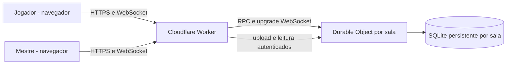

# Arquitetura | Arcane Table 0.3 beta

## Caminho principal

### Modelo de dados

**Sala:** id aleatório, nome, id do mapa ativo.

**Membro:** id, nome de exibição, papel (mestre/jogador), hash SHA-256 do token aleatório, ficha opcional e posição `(x,y)` em percentuais do tabuleiro.

**Ficha:** nome, espécie, classe, nível, PV atual/máx., CA, seis atributos, história e ID do retrato.

**Mensagens:** id, autor, tipo (texto/rolagem/sistema), conteúdo e timestamp. Limite de retenção: 120.

**Mídia:** id (UUID), tipo (retrato ou mapa), proprietário, MIME, bytes (BLOB) e tamanho no SQLite privado do Durable Object. Máximo de 18 MB e 30 arquivos por sala.

## Permissões

| Ação | Mestre | Jogador |
|---|---|---|
| Entrar na sala | Criador | Com link, até oito |
| Enviar chat/rolar dados | Sim | Sim |
| Criar/editar ficha própria | Sim | Sim |
| Enviar foto para sua ficha | Sim | Sim |
| Enviar/trocar mapa | Sim | Não |
| Mover seu token | Sim | Sim |
| Mover token de outro jogador | Sim | Não |
| Ver retratos e mapa da sala | Sim | Sim |

A identidade do membro não é enviada pelo cliente como autoridade: o servidor a deduz do token de sessão validado. A UI não é o mecanismo de segurança.

## Fluxo de entrada

1. Criador chama `POST /api/rooms`, recebe `roomId` e token de mestre.
2. Link contém **somente** `?room=<codigo>` (sem token de sessão).
3. Outro jogador chama `POST /api/rooms/:room/join` e recebe token próprio.
4. Ambos pedem o estado autenticado e abrem WebSocket com subprotocolos `arcane-v1` e `auth.<token>`.
5. Durable Object verifica token, aceita conexão, envia snapshot e sincroniza alterações de ficha, chat, rolagem e posição.

## Uploads

1. Cliente seleciona JPG/PNG/WebP; o navegador otimiza e converte para JPEG (até 900 KB retrato / 1,7 MB mapa).
2. POST autenticado com corpo binário para `/api/rooms/:id/media?kind=portrait|map`.
3. Worker verifica sessão, permissão, limite e bytes iniciais do formato.
4. Worker envia os bytes ao Durable Object, que valida a sessão e grava mídia no SQLite privado.
5. Outros membros fazem fetch autenticado; navegador gera Blob URL temporária. Não existe bucket público nem dependência de R2.

## Evolução planejada

- **0.3.1:** Testes automatizados E2E e rate limit por IP, controles de admissão/expulsão, revogação de sessão e backup/exportação.
- **0.4:** Grade configurável, foco e zoom, múltiplos mapas, inventário básico e preparação de cenas.
- **0.5:** Iniciativa, rolagens com modificadores, histórico de combate, ferramentas de mestre.
- **0.6:** Névoa de guerra, iluminação simples e ambientação sonora opcional.

## Decisões de escopo

**Sem 3D**, sem áudio/vídeo integrado e sem IA obrigatória. O tabuleiro representa a aventura, não tenta substituir o mestre. Evitar D1 na primeira versão porque o SQLite por Durable Object já persiste cada sala e reduz a infraestrutura. Uma eventual galeria global de fichas e contas poderá justificar D1 depois.
